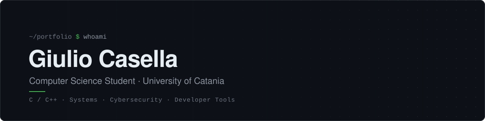

 

## About

I'm a Computer Science student (L-31) at the University of Catania, Department of Mathematics and Computer Science (DMI).
I love programming, and I'm passionate about **cybersecurity**: my goal is to work as a **penetration tester**, finding weaknesses in systems before someone else does.

I build tools that solve problems I actually have, usually for studying, and then share them with other students. I use AI to prototype faster, but I keep problem solving and design decisions on my side of the keyboard.

Before university I ran a YouTube channel, so I also bring experience in video editing and visual communication.

 

## Featured Projects

### Dispensa & Allenatore Prog2

A complete study kit for the Programming 2 exam (C++, OOP, dynamic data structures) at the University of Catania, built around the three parts of the exam: multiple-choice quiz, lab test and oral.

- **Handbook** &nbsp;295-page LaTeX book in 14 modules, from classes to graphs, with TikZ memory diagrams, light and dark editions and a separate solutions volume. Every code listing is compiled with `g++ -Wall -Wextra` and its real output is included automatically.
- **Desktop trainer** &nbsp;Windows app that parses the LaTeX sources live: timed exam simulations, spaced-repetition oral flashcards, and a C++ editor that compiles exercises and diffs the output against the reference solution. VS Code integration included.
- **Mobile app** &nbsp;Installable PWA for Android and iOS, works offline, with progress sync between devices via QR code.
- **Gamification** &nbsp;XP, levels, daily missions and an animated pixel-art companion; an original generative soundtrack synthesized with the Web Audio API.

`Python` `JavaScript` `HTML/CSS` `LaTeX` `TikZ` `C++` `pywebview` `PyInstaller` `PWA` `GitHub Actions`

[Project page](https://github.com/KurtSixxxx/MyUniversity/tree/main/Anno_01/Semestre_02/Programmazione%202/Dispensa%20e%20Allenatore) &nbsp;·&nbsp; [Download for Windows](https://github.com/KurtSixxxx/MyUniversity/releases/latest) &nbsp;·&nbsp; [Open on mobile](https://kurtsixxxx.github.io/MyUniversity/)

 

### MyUniversity

A structured archive of notes, handouts, past exams and exercises for the Computer Science degree at DMI, organized by year and semester and open to contributions from other students. Large files are managed with Git LFS, and the repository hosts the Prog2 kit with automated deployment to GitHub Pages.

`Git` `Git LFS` `Markdown` `LaTeX` `GitHub Pages`

[Repository](https://github.com/KurtSixxxx/MyUniversity)

 

### Telegram Bot &nbsp;private

A Telegram bot that lets users report road checkpoints in real time to a shared community.

`Python` `Telegram Bot API`

 

## Skills

| | |
|:--|:--|
| **Languages** | C, C++, Python, JavaScript, LaTeX |
| **Focus** | Cybersecurity, penetration testing |
| **Core topics** | OOP, data structures, algorithms and complexity |
| **Tools** | Git, GitHub Actions, VS Code, PowerShell, FFmpeg |
| **Other** | Technical writing, Notion, video editing, Adobe Photoshop |

 

## Education

**B.Sc. in Computer Science (L-31)** &nbsp;·&nbsp; University of Catania, DMI &nbsp;·&nbsp; *in progress*

 

## Contact

[Email](mailto:giuliocasella6@gmail.com) &nbsp;·&nbsp; [LinkedIn](https://www.linkedin.com/in/giuliofilippocasella) &nbsp;·&nbsp; [Instagram](https://instagram.com/giiulio27)

Open to collaborations, study projects and conversations about programming and offensive security.

 

&nbsp;
